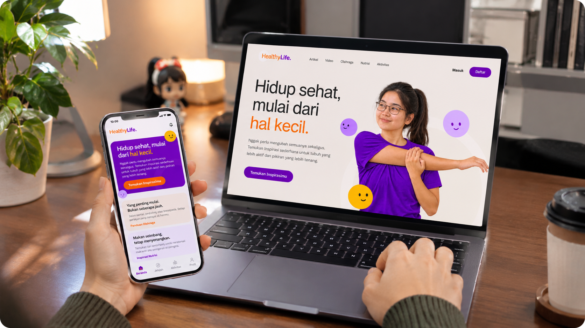
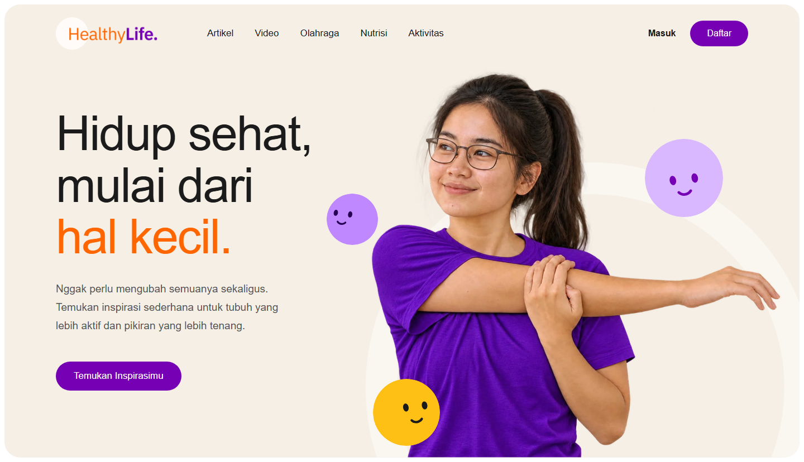
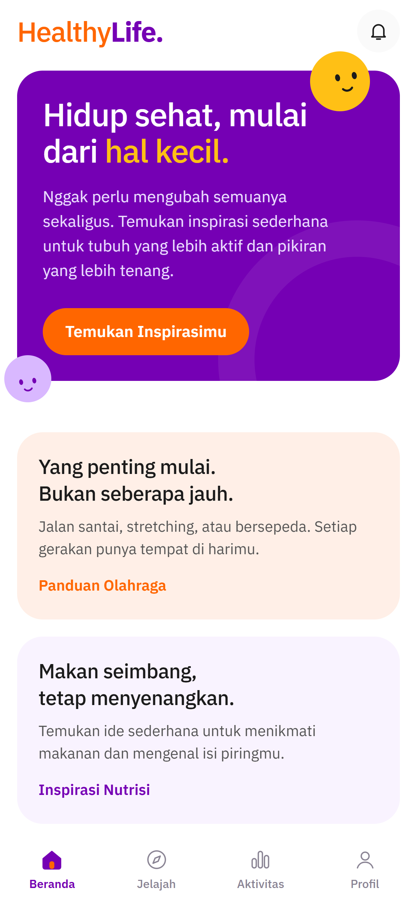

# HealthyLife

**Your Daily Healthy Habit**

HealthyLife adalah *specialized platform* di bidang health & wellness yang menggabungkan konten edukasi pola hidup sehat dengan pencatatan aktivitas pribadi. Platform ini terdiri dari aplikasi web, aplikasi mobile, dan satu REST API yang dipakai bersama oleh keduanya.

Proyek ini dibuat untuk mata kuliah Specialized Platform Development, BINUS Online Learning.



## Fitur

**Konten edukasi (tanpa login)**
- 30 konten dalam empat kategori: artikel, video, olahraga, dan nutrisi
- Filter kategori, pencarian kata kunci, dan paginasi
- Halaman detail berisi isi Markdown, embed YouTube untuk video, tag, sumber acuan, dan 3 konten terkait
- Penjadwalan terbit: 20 konten tampil saat rilis, 10 sisanya terbit bertahap

**Fitur personal (wajib login)**
- Registrasi dan login dengan JWT
- Catat aktivitas (jenis, durasi, tanggal, catatan), lihat riwayat per tanggal, dan hapus catatan
- Ringkasan 7 hari terakhir: grafik menit per hari, total mingguan, jumlah hari target tercapai, dan rata-rata
- Target harian yang bisa diatur (5–300 menit, default 30)
- Simpan konten favorit
- Notifikasi konten baru (web: lonceng di navbar, mobile: layar notifikasi)
- Pengingat lokal setiap pukul 19.00 (khusus mobile)

**Tambahan di web**
- Pilihan "kebiasaan sehat" di beranda
- Form catat aktivitas dan atur target

## Tech stack

| Bagian | Teknologi |
|---|---|
| Web | React 18 (create-react-app), React Router 6, Axios, react-markdown, GSAP, Lenis |
| Mobile | React Native (Expo SDK 58, expo-router), Axios, expo-secure-store, expo-notifications, react-native-svg, react-native-youtube-iframe |
| Server | Node.js, Express, Mongoose, JWT, bcryptjs |
| Database | MongoDB (lokal untuk pengembangan, MongoDB Atlas untuk produksi) |
| Deploy | Vercel (web), Railway (server), Expo Go dan APK lewat EAS (mobile) |

<p>
  
  
</p>

## Struktur folder

```
healthylife/
├── server/               REST API
│   ├── config/           koneksi database
│   ├── data/             data konten
│   ├── middleware/       auth dan error
│   ├── models/           skema database
│   ├── routes/           endpoint API
│   ├── utils/            zona waktu
│   ├── public/images/    thumbnail konten
│   └── seed.js           isi database
├── web/                  aplikasi web
│   ├── public/           aset statis
│   └── src/
│       ├── api/          klien Axios
│       ├── components/   komponen UI
│       ├── context/      state global
│       ├── data/         teks beranda
│       ├── pages/        halaman web
│       └── styles/       file CSS
├── mobile/               aplikasi mobile
│   └── src/
│       ├── app/          layar aplikasi
│       ├── components/   komponen UI
│       └── lib/          logika aplikasi
└── docs/screenshots/     gambar README
```

## Menjalankan secara lokal

Butuh Node.js v22+ dan MongoDB Community Server (atau URI MongoDB Atlas).

### 1. Server

```bash
cd server
cp .env.example .env    # isi MONGODB_URI dan JWT_SECRET
npm install
npm run seed            # isi 30 konten ke database
npm run dev             # http://localhost:5000
```

Isi `.env`:

```
PORT=5000
MONGODB_URI=mongodb://127.0.0.1:27017/healthylife
JWT_SECRET=ganti_dengan_string_acak_yang_panjang
```

### 2. Web

```bash
cd web
cp .env.example .env
npm install
npm start               # http://localhost:3000
npm run build           # build produksi ke folder build/
```

| Variabel | Keterangan |
|---|---|
| `REACT_APP_API_URL` | URL API, contoh `http://localhost:5000/api/v1` |
| `REACT_APP_SITE_URL` | URL web tanpa garis miring di akhir, dipakai untuk canonical dan gambar Open Graph. Wajib diisi juga di Environment Variables Vercel. |

### 3. Mobile

```bash
cd mobile
cp .env.example .env    # isi EXPO_PUBLIC_API_URL dengan IP laptop, contoh http://192.168.1.10:5000/api/v1
npm install
npx expo start          # scan QR dengan Expo Go
```

HP dan laptop harus terhubung ke Wi-Fi yang sama. Untuk build APK, ganti `EXPO_PUBLIC_API_URL` ke URL Railway, lalu jalankan:

```bash
npx eas-cli@latest build -p android --profile preview
```

## API

Semua endpoint memakai prefix `/api/v1`. Endpoint dengan kolom Login bertanda "Ya" butuh header `Authorization: Bearer <token>`.

| Method | Path | Login | Fungsi |
|---|---|---|---|
| POST | `/auth/register` | - | Daftar akun |
| POST | `/auth/login` | - | Masuk |
| GET | `/auth/me` | Ya | Data akun yang sedang login |
| GET | `/contents?category=&q=&page=&limit=` | - | Daftar konten yang sudah terbit |
| GET | `/contents/:slug` | - | Detail konten dan 3 konten terkait |
| GET | `/favorites` | Ya | Daftar favorit |
| POST | `/favorites/:contentId` | Ya | Tambah favorit |
| DELETE | `/favorites/:contentId` | Ya | Hapus favorit |
| GET | `/activities` | Ya | Riwayat aktivitas |
| POST | `/activities` | Ya | Catat aktivitas |
| DELETE | `/activities/:id` | Ya | Hapus aktivitas |
| GET | `/activities/summary` | Ya | Ringkasan hari ini dan 7 hari terakhir |
| GET | `/notifications` | Ya | Konten yang terbit sejak terakhir dicek |
| PUT | `/notifications/seen` | Ya | Tandai notifikasi sudah dilihat |
| PUT | `/users/target` | Ya | Ubah target harian |

Thumbnail konten disajikan statis di `/images/<slug>.jpg`.

## Model data

| Koleksi | Field utama |
|---|---|
| `users` | name, email, password (hash), dailyTarget, favorites, lastSeenAt |
| `contents` | no, title, slug, category, summary, body (Markdown), thumbnail, videoUrl, readTime, durationMinutes, level, tags, sources, publishedAt |
| `activities` | user, type, duration (menit), calories, note, date |

Kategori konten: `artikel`, `video`, `olahraga`, `nutrisi`.
Jenis aktivitas: `jalan`, `lari`, `bersepeda`, `gym`, `yoga`, `peregangan`, `lainnya`.

## Catatan

- **Penjadwalan konten.** Konten tidak diterbitkan dengan cron. Setiap konten punya `publishedAt`, dan API hanya mengembalikan konten dengan `publishedAt <= sekarang`. Seed menghitung jadwal dari waktu seed dijalankan.
- **Zona waktu.** Ringkasan harian dihitung dalam WIB (UTC+7), jadi pergantian hari mengikuti waktu Indonesia bagian barat.
- **Video.** Video ditampilkan lewat embed YouTube dari kanal resmi (misalnya Kemenkes RI), bukan disimpan di server, supaya tidak membebani penyimpanan dan bandwidth hosting.
- **Notifikasi.** Notifikasi konten baru dihitung dari `lastSeenAt` milik user. Pengingat 19.00 di mobile adalah notifikasi lokal yang dijadwalkan di perangkat, bukan push notification dari server.
- **Analytics.** Tag Google Analytics hanya dimuat di build produksi, jadi kunjungan saat `npm start` tidak ikut tercatat.
- **Hosting server.** Server di-deploy ke Railway karena verifikasi kartu di Render selalu gagal.
- **Sumber konten.** Konten ditulis ulang dengan mengacu pada WHO, Kementerian Kesehatan RI, CDC, dan lembaga resmi lain. Sumber dicantumkan di setiap konten.

## Link

| Item | URL |
|---|---|
| Web | https://healthylife-theta.vercel.app/ |
| Expo Go (QR) | https://expo.dev/accounts/cendysaputra-team/projects/healthylife/builds/a0ddfe54-1b79-48c5-8df4-aecdb14dd17f |
| APK | https://github.com/cendysaputra/healthylife/releases/tag/v1.0.0 |

## Disclaimer

Konten di HealthyLife bersifat edukasi dan bukan pengganti saran tenaga medis.


